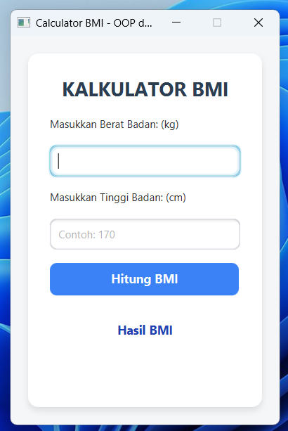
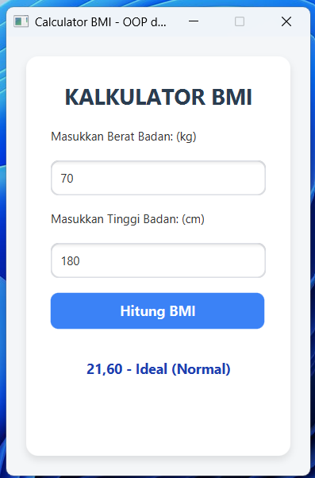

## Kalkulator BMI (Body Mass Index) - JavaFX

Aplikasi desktop interaktif untuk menghitung **Body Mass Index (BMI)** berbasis **JavaFX** dan dikembangkan menggunakan arsitektur **MVC (Model-View-Controller)**. Aplikasi ini membantu pengguna mengetahui status berat badan ideal secara praktis berdasarkan standar kriteria kesehatan.

---

## 📷 Tampilan Antarmuka (UI Preview)

<p align="center">
  
  
</p>

---

## Fitur Utama

- **Kalkulasi Akurat**: Menghitung indeks massa tubuh berdasarkan tinggi (cm) dan berat badan (kg).
- **Kategori Status Otomatis**: Menampilkan status BMI (Kurus, Ideal, Gemuk, Obesitas).
- **Validasi Input & Error Handling**: Mencegah kesalahan input (kolom kosong, huruf/karakter tidak valid, serta angka $\le 0$).
- **Antarmuka Modern**: Tampilan GUI yang bersih dan responsif didesain menggunakan **Scene Builder**.

---

## Kategori Status BMI (WHO / Asia-Pasifik)

| Rentang BMI | Kategori | Detail Deskripsi |
| :---: | :---: | :--- |
| **< 18.5** |  **Kurus** | *Underweight* (Kurang Berat Badan) |
| **18.5 – 24.9** |  **Ideal** | *Normal Weight* (Berat Badan Ideal) |
| **25.0 – 29.9** |  **Gemuk** | *Overweight* (Kelebihan Berat Badan) |
| **≥ 30.0** |  **Obesitas** | *Obese* (Sangat Kelebihan Berat Badan) |

---

## Teknologi & Tools

- **Bahasa Pemrograman**: Java (JDK 17/21)
- **GUI Framework**: JavaFX
- **Build Tool**: Maven
- **IDE**: NetBeans
- **Design Tool**: Scene Builder

---

## 📁 Struktur Proyek (MVC Architecture)

Proyek ini menggunakan pola desain **Model-View-Controller (MVC)** untuk memisahkan logika bisnis, antarmuka pengguna, dan pengontrol:

```text
src/
 ├── main/
 │    ├── java/
 │    │    ├── controller/
 │    │    │    └── KalkulatorBMIController.java  # Mengontrol logika event GUI
 │    │    ├── main/
 │    │    │    └── MainApp.java                  # Entry point aplikasi JavaFX
 │    │    └── model/
 │    │         └── CalculatorBMI2.java           # Logika bisnis & kalkulasi BMI
 │    └── resources/
 │         └── KalkulatorBMI.fxml                 # Desain antarmuka (XML)
 └── pom.xml

 
Proyek ini dibuat untuk tujuan pembelajaran Pemrograman Lanjut / Object-Oriented Programming (OOP) dan GUI